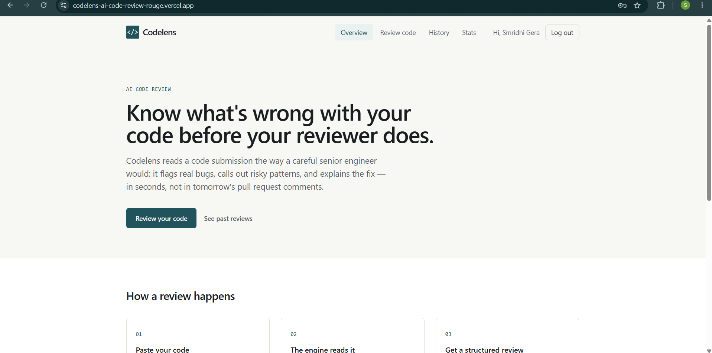
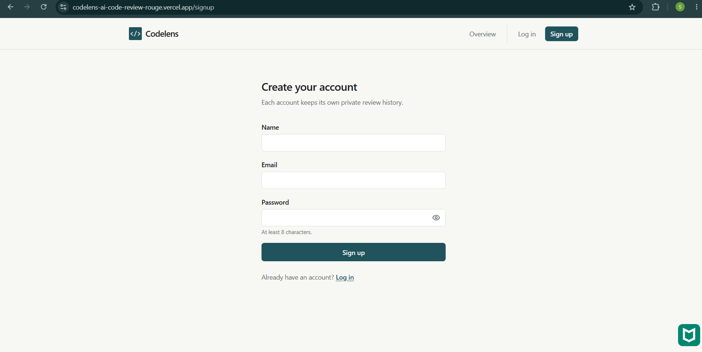
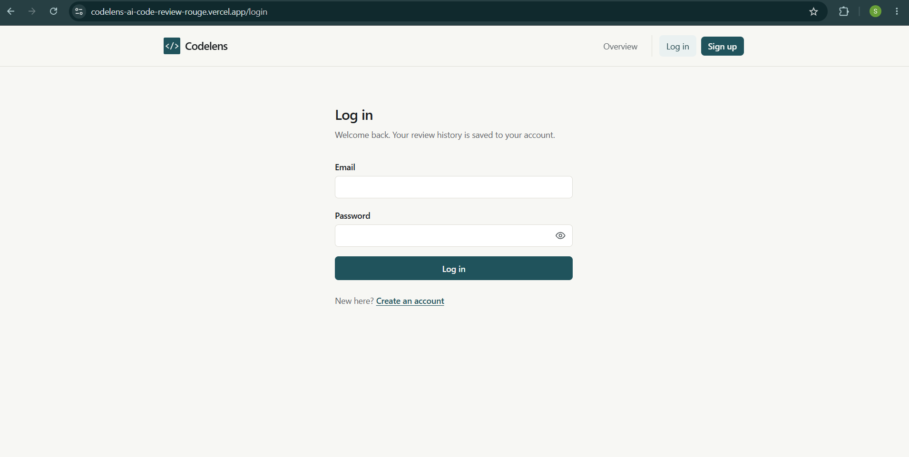
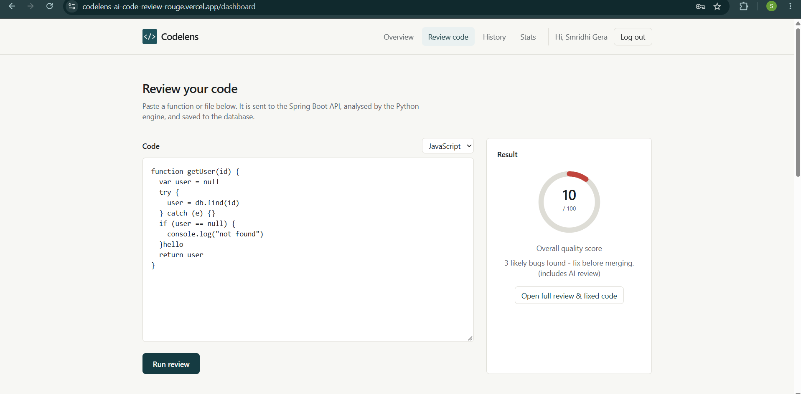
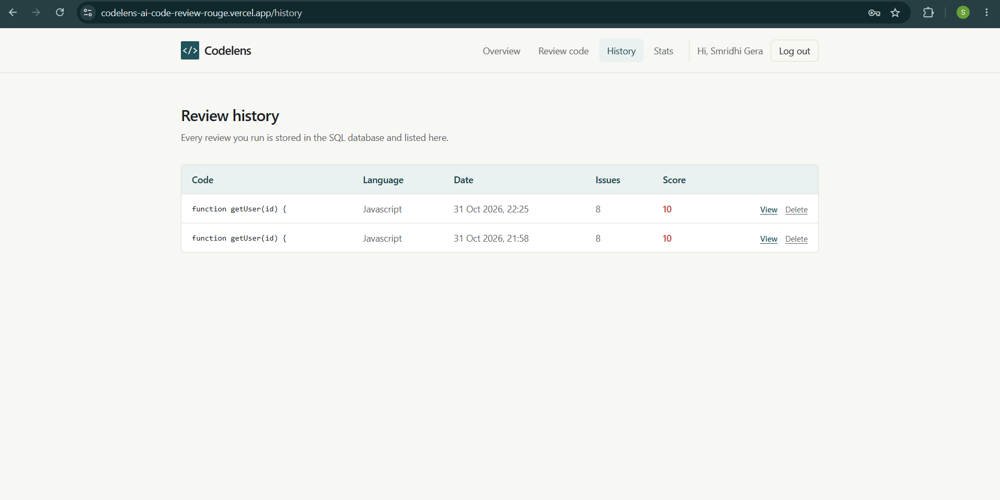
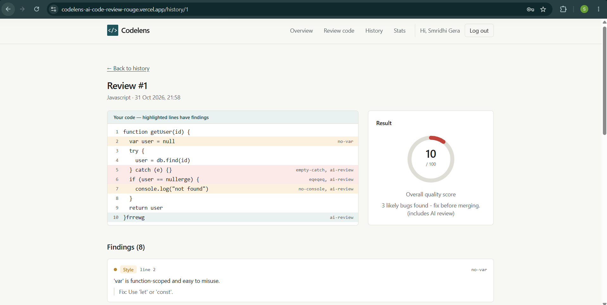
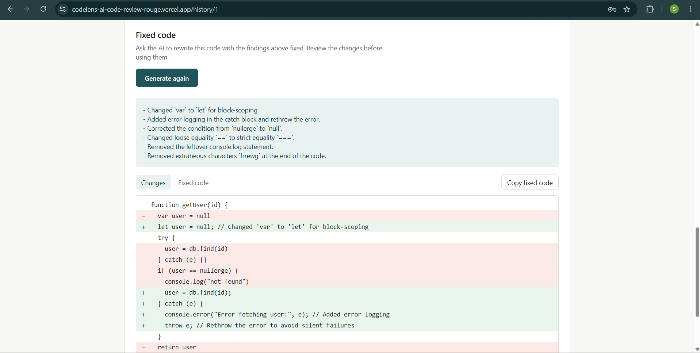
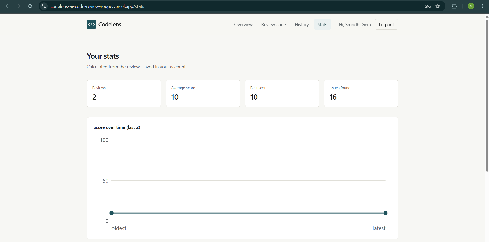

# Codelens - AI Code Review Platform

Codelens reads a code submission the way a careful senior engineer would: it flags real bugs, calls out risky patterns and explains the fix, in seconds. Every user gets a private review history, a score trend and an AI-generated "fixed code" view.

## Live demo

| Part | Link |
|------|------|
| Website (open this one) | https://codelens-ai-code-review-rouge.vercel.app |
| Backend API | https://codelens-backend-bx0x.onrender.com |
| AI engine health check | https://codelens-engine.onrender.com/health |
| Source code | https://github.com/smridhi-here/codelens-Ai-code-review |

### Important: the free servers sleep

The backend and AI engine run on Render's free plan. They go to sleep after 15 minutes without use, and waking them takes 1 to 2 minutes (the Spring Boot backend is the slowest). If the site shows **"Cannot reach the backend"** or **"AI engine is not reachable"**, wake the servers by opening these links, **one at a time, in this order**, and wait for each to load:

1. AI engine: https://codelens-engine.onrender.com/health (should show `status: ok`)
2. Backend: https://codelens-backend-bx0x.onrender.com (a 401 / 403 / error page is fine, it only means the server is awake)
3. Website: https://codelens-ai-code-review-rouge.vercel.app

Then try again. For a demo, do this about 5 minutes beforehand.

## Screenshots

| Home | Sign up |
|------|---------|
|  |  |

| Log in | Review result |
|--------|---------------|
|  |  |

| History | Review detail with highlighted lines |
|---------|--------------------------------------|
|  |  |

| AI fixed code (before / after) | Stats |
|--------------------------------|-------|
|  |  |

## Features

- **Sign up / log in** with BCrypt password hashing and JWT tokens (valid 24 hours), with a show / hide password eye
- **Review code**: paste JavaScript or Python and get a score and a list of findings
- **History**: all your past reviews in one place
- **Review detail**: your code with the problem lines highlighted, and each finding explained
- **AI "Show fixed code"**: a before / after diff with a copy button (limited to about 12,000 characters)
- **Stats**: score trend over time, most common issues, issues by type
- **Private data**: each user only sees, opens and deletes their own reviews

## How the AI works (honest description)

The review engine is a **hybrid**, not a trained machine-learning model:

1. **Parsers**: Python code is parsed with the `ast` module, JavaScript is syntax-checked with Node (`node --check`)
2. **Fixed rules**: a set of static-analysis rules for common problems
3. **LLM review**: a large language model called through OpenRouter adds explanations and suggested fixes (it falls back to `openrouter/auto` if the chosen model is removed)

Supported languages: **JavaScript** and **Python**.

## Technologies used

| Layer | Technologies |
|-------|--------------|
| Frontend | Next.js 14 (App Router), React 18, Tailwind CSS, JavaScript, browser `localStorage` for the login token |
| Backend | Java 17, Spring Boot 3.3.5, Spring Security, JWT (jjwt 0.12.6), BCrypt, Spring Data JPA / Hibernate, Maven |
| AI engine | Python, FastAPI, Uvicorn, Pydantic, Python `ast` module, Node.js (`node --check`), OpenRouter API (LLM) |
| Database | H2 (local development), PostgreSQL on Neon (deployed), MySQL optional |
| Deployment | Docker, GitHub, Render (backend and AI engine), Vercel (frontend), Neon (database) |
| Tools | VS Code, Git |

## Architecture

```
Browser (Next.js) -> Spring Boot API -> Python AI engine (FastAPI) -> OpenRouter (LLM)
                           |
                           v
                  SQL database (H2 locally, PostgreSQL when deployed)
```

| Folder | What it is | Local port |
|--------|-----------|------------|
| `frontend/` | Next.js 14 (App Router), React 18, Tailwind CSS | 3000 |
| `backend/` | Spring Boot 3.3.5, Java 17, Spring Security + JWT, JPA / Hibernate | 8080 |
| `ai-engine/` | Python FastAPI: parsers + rules + OpenRouter LLM review | 8000 |
| `docs/` | `schema.sql` (database design) | |
| `screenshots/` | pictures used in this README | |

### Where it is deployed (all free tiers)

| Part | Service |
|------|---------|
| Frontend | Vercel (Hobby) |
| Backend | Render Web Service (Docker, Free) |
| AI engine | Render Web Service (Docker, Free) |
| Database | Neon (serverless PostgreSQL) |

## Run it on your own computer

You need Node.js, JDK 17 and Python. Start the three parts in this order, each in its own terminal.

### 1. Python AI engine
```
cd ai-engine
pip install -r requirements.txt
python -m uvicorn main:app --reload --port 8000
```
For the AI review, copy `.env.example` to `.env` and add your OpenRouter key (`OPENROUTER_API_KEY`, `OPENROUTER_MODEL`).
Check: http://localhost:8000/health

### 2. Spring Boot backend
Open the `backend` folder in VS Code (Extension Pack for Java) or IntelliJ and run `CodelensApplication`. Starting takes about 2 minutes.
Check: http://localhost:8080/api/reviews should answer `401` (login required). That means it is running and protected.

H2 console: http://localhost:8080/h2-console (JDBC URL `jdbc:h2:file:./data/codelens`, user `sa`, empty password).

### 3. Frontend
```
cd frontend
npm install
npm run dev
```
Open http://localhost:3000, sign up, then review some code.

## API

| Method | URL | Login needed | What it does |
|--------|-----|--------------|--------------|
| POST | /api/auth/signup | no | create an account, returns a token |
| POST | /api/auth/login | no | log in, returns a token |
| POST | /api/review | yes | analyse code and save it under your account |
| GET | /api/reviews | yes | your reviews (History page) |
| GET | /api/reviews/{id} | yes | one of your reviews with all issues |
| POST | /api/reviews/{id}/fix | yes | AI-corrected version of that code |
| GET | /api/stats | yes | your totals, trend and top issues |
| DELETE | /api/reviews/{id} | yes | delete one of your reviews |

## How login works

1. Sign up / log in: Spring Boot checks the password (BCrypt hash) and returns a signed JWT (valid 24 hours).
2. The browser keeps the token and sends `Authorization: Bearer <token>` with every request.
3. A filter reads the token and finds the user, and every review is saved under that user.

## Deployment settings (environment variables)

No secrets are stored in this repository. They are set in each hosting dashboard.

| Service | Variables |
|---------|-----------|
| AI engine (Render) | `OPENROUTER_API_KEY`, `OPENROUTER_MODEL`, `ENGINE_API_KEY` |
| Backend (Render) | `JDBC_DATABASE_URL`, `DB_USER`, `DB_PASSWORD`, `JWT_SECRET`, `AI_ENGINE_URL`, `ENGINE_API_KEY`, `CORS_ORIGINS` |
| Frontend (Vercel) | `NEXT_PUBLIC_API_URL` |

The full step-by-step guide is in [DEPLOY.md](DEPLOY.md).

## Troubleshooting

| Problem | Likely cause and fix |
|---------|----------------------|
| "Cannot reach the backend" | Online: the backend is asleep, wake it with the links above. Locally: Spring Boot is not running. |
| "AI engine is not reachable" | Online: the engine is asleep, open its `/health` link and wait. Locally: the Python service is not running on port 8000. |
| CORS error in the browser console | `CORS_ORIGINS` on the backend must be the exact website address, including `https://` and with no `/` at the end. |
| Sent back to the login page | The token expired (24 hours) or the backend restarted with a new `JWT_SECRET`. |
| First request is very slow online | The free servers were asleep and are waking up. |

## Limitations

- Supports JavaScript and Python only
- AI fix is limited to about 12,000 characters of code
- The review is hybrid (parsers, rules and an LLM), so results can vary and should be read as guidance, not proof
- On the free hosting plan the servers sleep after 15 minutes of inactivity
